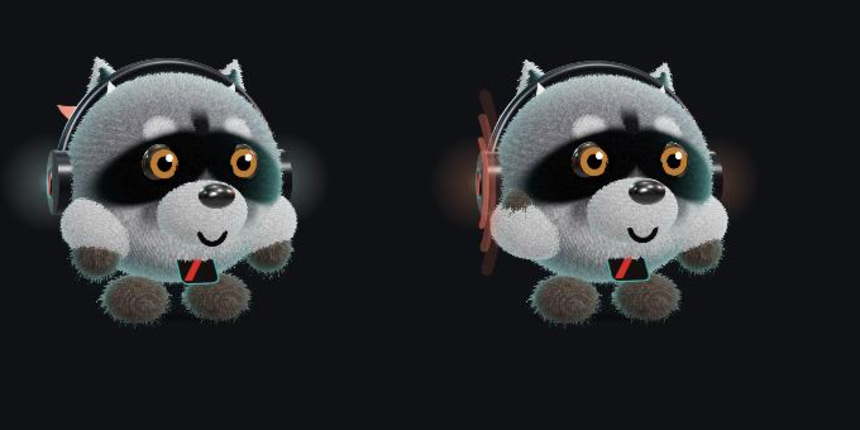
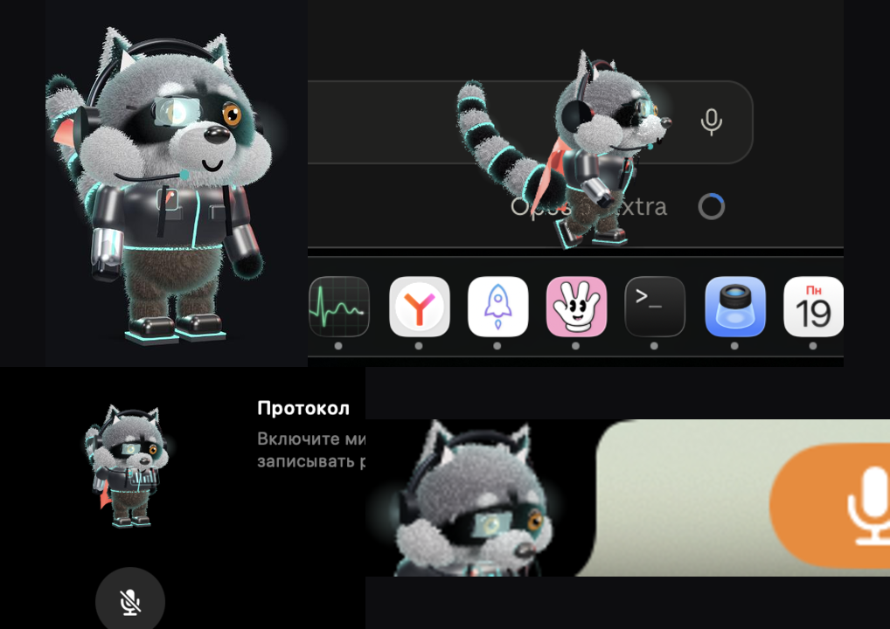

# Андреич — живой енот в чёлке макбука

   

Нативный ассистент, который живёт в вырезе MacBook. Пушистый 3D-киберенот: слушает, ведёт протокол твоих мыслей, превращает болтовню в задачи и гуляет по экрану, когда всё сделано.



Весь проект — Swift без Xcode плюс three.js — написан в диалоге с Claude Code, без единой строчки руками.

## Что умеет

- **Живёт в чёлке.** Наводишь мышь — вырез раскрывается в панель. В покое из «крыла» выглядывает 3D-морда.
- **Слушает и ведёт протокол.** Жмёшь ⌥⌘M (или кнопку) — распознаёт русскую речь прямо на Маке и пишет протокол дня в markdown. Звук дублируется в m4a — ничего не теряется. Всё локально, никуда не уходит.
- **Превращает слова в дела.** Сказал вслух «надо в 7 поставить будильник» — Андреич предлагает карточку, галочка кладёт её в Напоминания. Сказал «надо бы в проекте X поправить то-то» — он пишет готовый промт, спрашивает «ок?» в Telegram и по ответу сам отправляет задачу в нужную сессию Claude Code.
- **Сводка дня** — по кнопке или вечером сама в Telegram: о чём говорил, что решено, что повисло.
- **Следит за сессиями Claude** и показывает лимиты подписки: сколько недельных осталось и сколько можно сжечь сегодня.
- **Полка для файлов.** Кинул файл в чёлку — лежит копией, вытащил — скопировался. Плюс кнопка и ⌘V.
- **Гуляет по экрану.** Когда вся работа закончена, выпрыгивает из чёлки и идёт вдоль дока: плащ летит, хвост качается. Началась работа — молча возвращается.
- **Три облика**: пушистый кругляш, полный рост в куртке с эмблемой, и плоский конструктивист для сайта. Переключаются из меню.



## Установка

Нужен macOS 14+ и Swift из Command Line Tools (Xcode не нужен). Для 3D-сборки — Node.js.

```bash
git clone https://github.com/OAIWEB/andreich.git
cd andreich
./scripts/build-app.sh
open Андреич.app
```

При первом включении микрофона macOS спросит разрешения на микрофон и распознавание речи — распознавание работает на устройстве, через движок диктовки Apple. Карточки в Напоминания попросят доступ к Напоминаниям.

Анализ речи и сводки используют Claude Code (`claude -p`, модель haiku) — нужен установленный [Claude Code](https://claude.com/claude-code) с подпиской. Без него протокол и полка работают, карточек и сводок не будет.

Telegram-сводки: положи `TG_BOT_TOKEN` и `TG_CHAT_ID` в `~/Library/Application Support/AndreichNotch/telegram.env`.

## Горячее

- `⌥⌘M` — микрофон вкл/выкл из любого приложения
- меню-лапка → «Позвать погулять», «Вид: кругляш / полный рост»
- `ANDREICH_OPEN=1 ANDREICH_PIN=1 open -a Андреич.app` — отладка панели

## Устройство

- `Sources/` — Swift: окно над вырезом (NSPanel поверх меню-бара), распознавание (SFSpeechRecognizer ru, on-device), протокол, полка, монитор сессий и лимитов, диспетчер промтов.
- `andreich3d/` — three.js: мех оболочками (instanced shell fur), плащ-ткань на верле, процедурные позы; `preview.html` — песочница с кнопками поз.
- Приём с окном поверх выреза подсмотрен в открытом [Atoll](https://github.com/rutmehta/Atoll) (MIT); код написан заново.

## Частые вопросы

**Звук куда-то уходит?» — Нет.** Распознавание работает на самом Маке (движок диктовки Apple), записи лежат в `~/Library/Application Support/AndreichNotch/`. В сеть текст попадает только когда Андреич готовит карточки и сводки — через твой же Claude Code.

**Чёлка обязательна?** Нет: на маках без выреза панель живёт у верхнего края экрана.

**Тяжёлый?** В покое ~2–3% одного ядра и ~90 МБ на 3D.

## Автор

[OAI WEB IT](https://oaiweb.ru) — внедряем ИИ-сотрудников в бизнес. Telegram: [@oaiweb](https://t.me/oaiweb).

Лицензия MIT.

⭐ Если енот зашёл — поставь звезду: по ним его находят другие.
